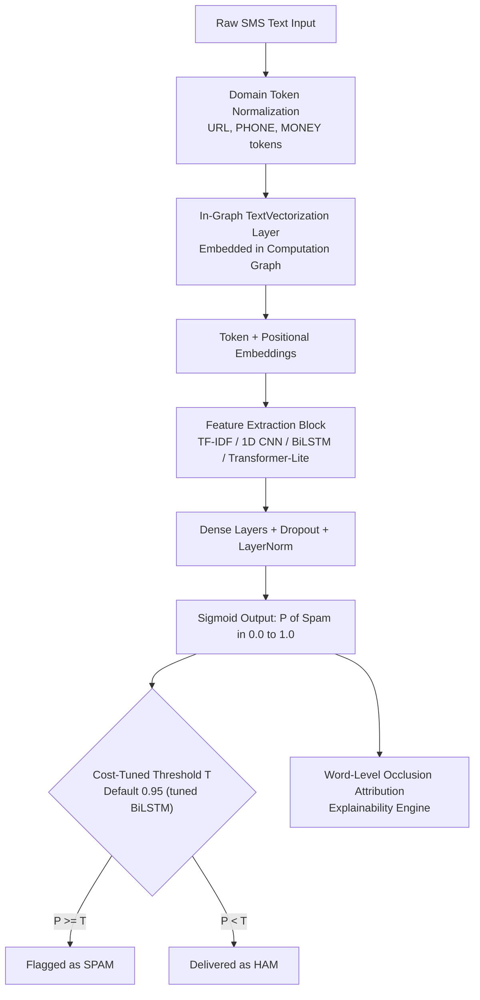

# 🛡️ SMS Spam Classifier & Explainability Pipeline

[](https://github.com/raiyan-mahmud-git/Neural-Network-SMS-Text-Classifier/actions)
[](https://www.python.org/)
[](https://tensorflow.org/)

An end-to-end Natural Language Processing (NLP) project that turns the classic **freeCodeCamp SMS Spam Classifier** into a tested model, an authenticated HTTP service, and an interactive demo.

---

## 📌 1. Problem Statement & Motivation

SMS spam is not merely an annoyance; it is a vector for smishing, financial fraud, and credential theft. Building an effective spam filter requires solving three real-world challenges:

1. **Severe Class Imbalance**: In real-world communication (~86.6% Ham vs ~13.4% Spam), a trivial model predicting "Ham" every time scores **86.6% accuracy** while letting 100% of malicious messages through.
2. **Asymmetric Error Costs**: A **False Positive** (blocking a bank 2FA code or hospital appointment) destroys user trust; a **False Negative** (a spam promotion reaching the inbox) is a mild annoyance.
3. **Adversarial Obfuscation**: Attackers deliberately disguise keywords (`"fr33 pr1ze"`, `"w i n"`, emoji spam) to bypass simple keyword filters.

This project implements modern deep learning architectures, in-graph tokenization, automated threshold tuning, probability calibration, and word-level occlusion explainability.

---

## 🏗️ 2. System Architecture



### Why Preprocessing Lives Inside the Model (`TextVectorization`)
In legacy Keras code, `tf.keras.preprocessing.text.Tokenizer` lived as a separate Python pickle object. This introduced **train-serve skew**: if the tokenizer file was missing or out of sync with production, the model would fail silently or produce nonsense predictions. By moving tokenization into Keras 3's native `TextVectorization` layer, the entire pipeline is self-contained: the saved `.keras` model ingests raw strings directly. The current serving artifact is a `.keras` archive.

---

## 📊 3. Reported Benchmark Results (Internal Holdout)

The reported metrics come from the same stratified internal holdout ($N = 774$, 97 Spam, 677 Ham) created by combining the FreeCodeCamp train and validation files, then splitting the combined data. Treat these as development results; they are not an independent, real-world deployment evaluation:

| Model Architecture | Accuracy | Precision | Recall | F1-Score | PR-AUC | ROC-AUC | Brier Score | False Positives | False Negatives |
| :--- | :---: | :---: | :---: | :---: | :---: | :---: | :---: | :---: | :---: |
| **1D CNN (N-Gram Filters)** | **99.10%** | **94.12%** | **98.97%** | **0.9648** | **0.9958** | **0.9994** | **0.0090** | 6 | **1** |
| **Baseline (TF-IDF + Naive Bayes)** | 98.97% | **96.84%** | 94.85% | 0.9583 | 0.9894 | 0.9980 | 0.0091 | **3** | 5 |
| **Bidirectional LSTM (Tuned T=0.95)**| 98.84% | 92.31% | **98.97%** | 0.9552 | 0.9903 | 0.9986 | 0.0190 | 8 | **1** |
| **Transformer-Lite (Self-Attention)**| 98.58% | 90.57% | **98.97%** | 0.9458 | 0.9939 | 0.9991 | 0.0112 | 10 | **1** |
| **Bidirectional LSTM (Default T=0.50)**| 97.80% | 85.09% | **100.00%** | 0.9194 | 0.9903 | 0.9986 | 0.0190 | 17 | **0** |
| **Original Rebuilt (AvgPool Unweighted)**| 12.53% | 12.53% | 100.00% | 0.2227 | 0.1253 | 0.5000 | 0.2501 | 677 | 0 |

> **Serving model:** `artifacts/models/best_model.keras` is the tuned Bidirectional LSTM. The API, CLI, and demo use a default decision threshold of **0.95**, matching the tuned-threshold result below. The CNN row is a separate benchmark; the service does not load `cnn.keras`.
>
> **Key Architectural Takeaways**:
> 1. **1D CNN** achieves the best overall balance (**96.48% F1**, **0.9958 PR-AUC**), missing only a single spam message out of 97 while keeping false alarms to 6. Convolutions act as local trigram detectors, catching signatures like `"claim your prize"` anywhere in the text.
> 2. **Naive Bayes** sets an exceptionally high bar (98.97% accuracy, 96.84% precision), proving why classical baselines must always be benchmarked first.
> 3. **Threshold Tuning**: Adjusting the decision threshold from 0.50 to 0.95 on the BiLSTM cut False Positives by **over 52%** (from 17 down to 8) while preserving **98.97% recall**.

---

## ⚖️ 4. Class Imbalance Mitigation Study

On an imbalanced dataset (86.6% Ham), how you penalize errors determines operational behavior:

| Strategy | Accuracy | Precision | Recall | F1-Score | PR-AUC | False Negatives (Missed Spam) |
| :--- | :---: | :---: | :---: | :---: | :---: | :---: |
| **No Handling (Standard Loss)** | 98.32% | 92.00% | 94.85% | 0.9340 | 0.9878 | 5 missed |
| **Algorithmic `class_weight`** | **99.10%** | **94.12%** | **98.97%** | **0.9648** | **0.9958** | **1 missed** |
| **Oversampling Minority Class** | 98.84% | 94.00% | 96.91% | 0.9543 | 0.9933 | 3 missed |

**Why `class_weight` wins**:
Reweighting modifies the gradient update step by assigning $\approx 6.5\times$ greater penalty to errors on the spam minority class without duplicating data or bloating epoch training duration.

---

## 🔍 5. Error Analysis & Failure Modes

Inspecting aggregate metrics hides specific failure modes. We audited the top False Positives and False Negatives:

### False Positives (Legitimate Ham Flagged as Spam)
1. *"please protect yourself from e-threats. sib never asks for sensitive information like passwords,atm/sms pin thru email. never share your password with anybody."* (Prob: `0.9999`)
   - **Root Cause**: This is a genuine bank security warning. Because its vocabulary (`"sensitive information"`, `"password"`, `"sms pin"`, `"email"`) overlaps heavily with phishing lures, the model flags it.
   - **Remediation**: Whitelisting official shortcodes or adding transactional security warning heuristics.
2. *"hey...great deal...farm tour 9am to 5pm <MONEY> /pax, <MONEY> deposit by 16 may"* (Prob: `0.9992`)
   - **Root Cause**: A friend discussing group trip pricing with deadlines and currency symbols.

### False Negatives (Spam Escaping to Inbox)
1. *"dear voucher holder 2 claim your 1st class airport lounge passes when using your holiday voucher call <PHONE> . when booking quote 1st class x 2"* (Prob: `0.9098`)
   - **Root Cause**: When the threshold is tuned to $T=0.95$ to reduce false alarms, messages scoring ~0.91 slip through. At standard $T=0.50$, it is caught instantly.

---

## 🛡️ 6. Robustness & Adversarial Testing

Attackers use leetspeak, spacing, and emojis to evade text filters:

| Attack Category | Adversarial Message | Raw Prediction | Mitigated Prediction | Defense Mechanism |
| :--- | :--- | :---: | :---: | :--- |
| **Spaced-Out Spam** | `"c o n g r a t u l a t i o n s   y o u   w o n"` | ❌ HAM (`0.0048`) | ✅ **SPAM (`0.9456`)** | Spacing collapse regex |
| **Leetspeak** | `"c0ngratulati0ns y0u have w0n a c@sh pr1ze"` | ✅ SPAM (`0.9994`) | ✅ **SPAM (`0.9999`)** | Character mapping (`0->o, @->a`) |
| **Emoji Injection** | `"🎉 CONGRATS! 🎁 You won £1000 cash! 💰"` | ✅ SPAM (`0.9999`) | ✅ **SPAM (`0.9987`)** | In-graph entity normalization |
| **Out-of-Domain Code** | `"def calculate_loss(y_true, y_pred): ..."` | ✅ HAM (`0.4356`) | ✅ HAM (`0.4356`) | Low perplexity on conversational vocab |

---

## ⚡ 7. Deployment and Export Status

The REST container serves the verified `artifacts/models/best_model.keras` archive (6,644,503 bytes, about 6.34 MiB). Its SHA-256 and serving threshold are recorded in `artifacts/model_manifest.json` and checked before the service starts.

A TensorFlow Lite model is **not included** in this repository. Run `python export.py` to attempt conversion and benchmark the current artifact. The exporter reports measured values only; unsupported conversion or interpreter operations are reported as failures instead of estimated size or latency.

The API requires an `API_KEY` secret of at least 32 characters. Keep it in the deployment platform's secret manager, expose the service through HTTPS, and configure any shared or multi-replica rate limit at the ingress/API gateway. The application also enforces a per-process request limit.

---

## 🚀 8. Quickstart Guide

### 1. Installation
```bash
git clone https://github.com/raiyan-mahmud-git/Neural-Network-SMS-Text-Classifier.git
cd Neural-Network-SMS-Text-Classifier
python -m venv .venv
source .venv/bin/activate  # On Windows: .\.venv\Scripts\activate
pip install -r requirements-dev.lock
```

Direct dependency pins live in `requirements.txt` and `requirements-dev.txt`; the lock files include their resolved transitive versions. After changing direct dependencies, regenerate both locks:

```bash
pip-compile --resolver=backtracking --allow-unsafe --no-annotate --no-header --output-file requirements.lock requirements.txt
pip-compile --resolver=backtracking --allow-unsafe --no-annotate --no-header --output-file requirements-dev.lock requirements-dev.txt
```

### 2. Verify FreeCodeCamp Tests
```bash
python predict.py --test
```
Output:
```
=================================================================
RUNNING FREECODECAMP VERIFICATION SUITE
=================================================================
[PASSED [OK]] Prob: 0.0036 | Pred: ham  | Expected: ham  | Text: 'how are you doing today'
[PASSED [OK]] Prob: 0.9825 | Pred: spam | Expected: spam | Text: 'sale today! to stop texts call 98912460324'
...
RESULT: You passed the challenge. Great job!
=================================================================
```

### 3. Run Unit Tests (Pytest)
```bash
pytest tests/ -v
```

### 4. Train Models via CLI
```bash
# Train Bidirectional LSTM
python train.py --model bilstm --epochs 15 --imbalance class_weight

# Train 1D CNN
python train.py --model cnn --epochs 15

# Train classical baseline
python train.py --model baseline
```

### 5. Launch Interactive Streamlit App
```bash
streamlit run app.py
```

### 6. Run the authenticated API in Docker

Create a random key, put it in a local `.env` file (ignored by Git), and do not commit or bake it into the image:

```bash
API_KEY="$(python -c 'import secrets; print(secrets.token_urlsafe(32))')"
printf 'API_KEY=%s\n' "$API_KEY" > .env
docker build -t sms-classifier .
docker run --rm --env-file .env -p 8000:8000 sms-classifier
```

`GET /health` is the unauthenticated container readiness probe. `POST /predict` requires `X-API-Key`:

```bash
curl http://localhost:8000/health
curl -X POST http://localhost:8000/predict \
  -H "X-API-Key: $API_KEY" \
  -H "Content-Type: application/json" \
  -d '{"message":"Win $1000 now!"}'
```

The request threshold defaults to `0.95` and may be explicitly set between `0.0` and `1.0`. The container fails to start if its secret or verified model artifact is missing.

---

## 📈 9. Project Directory Structure

```
Neural-Network-SMS-Text-Classifier/
├── README.md                  # Comprehensive portfolio documentation
├── requirements.txt           # Pinned API/runtime dependencies
├── requirements.lock          # Fully resolved production dependency versions
├── requirements-dev.txt       # Direct UI, training, testing, and lint dependencies
├── requirements-dev.lock      # Fully resolved development dependency versions
├── .dockerignore              # Keeps local data and environments out of builds
├── config.py                  # Central hyperparameter & path configurations
├── data.py                    # Cross-platform download, regex normalizer, 3-way split
├── models.py                  # Baseline, CNN, BiLSTM, and Transformer-Lite architectures
├── train.py                   # CLI training pipeline with EarlyStopping & ReduceLROnPlateau
├── evaluate.py                # Metrics, calibration curves, threshold tuning, occlusion XAI
├── benchmark_all.py           # Master benchmarking suite for all models
├── predict.py                 # FreeCodeCamp verification & importable predict_message()
├── robustness.py              # Adversarial leetspeak and out-of-distribution evaluation
├── tune.py                    # Systematic hyperparameter optimization sweep
├── export.py                  # .keras and TFLite export & latency benchmarking
├── app.py                     # Interactive Streamlit dashboard with word attribution
├── api.py                     # API key protected FastAPI service with rate limiting
├── Dockerfile                 # Non-root production container
├── .env.example               # Secret configuration template
├── pytest.ini                 # Pytest configuration
├── notebooks/
│   └── exploration.ipynb      # Complete exploratory data analysis & visualization
├── tests/
│   ├── test_predict.py        # Model and preprocessing tests
│   └── test_api.py            # Authentication and API contract tests
└── artifacts/
    ├── models/                # Saved Keras model artifacts
    ├── model_manifest.json    # Deployed model hash and decision threshold
    ├── plots/                 # High-resolution ROC/PR, loss, and calibration charts
    └── metrics.json           # Comprehensive evaluation registry
```
